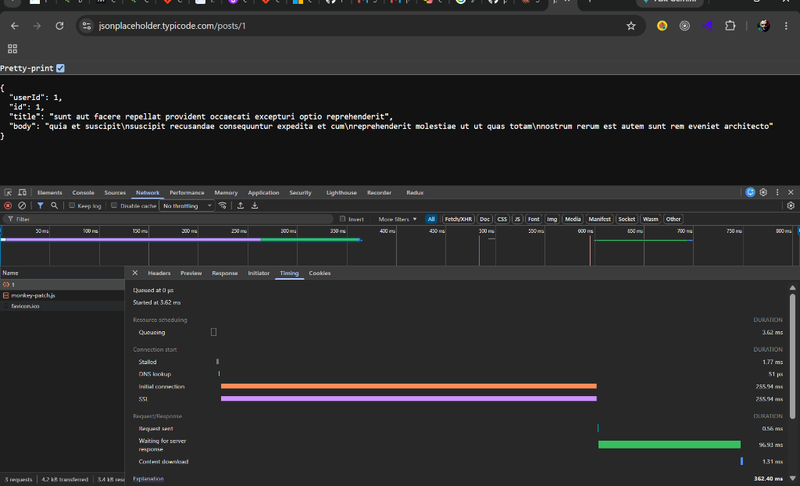

# P2.3 - Sessions, Cookies, Tokens & Browser DevTools

Notes on how web servers maintain state (cookies vs. bearer tokens), JWT structure, and inspecting network requests and timing phases in Chrome DevTools.

---

## 1. Postman Echo Experiments: Cookies vs. Bearer Tokens

### Experiment A: Automatic Cookie Handling
1. Called `GET https://postman-echo.com/cookies/set?course=perf`.  
   The server returned a response with the header:  
   `Set-Cookie: course=perf; Path=/`
2. Next, called `GET https://postman-echo.com/cookies`.  
   Without manually adding any header, the client automatically sent the stored cookie back.  
   The server response echoed it back:
   ```json
   {
     "cookies": {
       "course": "perf"
     }
   }
   ```

### Experiment B: Bearer Token Passing
Called `GET https://postman-echo.com/headers` with a custom header:  
`Authorization: Bearer practice-token-123`  
The server echoed back:
```json
{
  "headers": {
    "host": "postman-echo.com",
    "authorization": "Bearer practice-token-123",
    "user-agent": "PostmanRuntime/7.43.0"
  }
}
```

### Key Difference: Cookies vs. Bearer Tokens
- **Cookie**: Stored automatically by the browser/client when a `Set-Cookie` header is received. The client automatically includes the cookie on subsequent requests to that domain without explicit code.
- **Bearer Token**: Not handled automatically by default. The client code (or test script) must explicitly read the token and add it to the `Authorization: Bearer <token>` header on every single outgoing request.

---

## 2. JWT (JSON Web Token) Structure

A JWT is a compact, URL-safe string made of three parts separated by periods (`.`):

`header.payload.signature`

1. **Header**:  
   Contains metadata about the token, typically the algorithm used (`alg`, like `HS256` or `RS256`) and the token type (`typ: "JWT"`).
2. **Payload**:  
   Contains the "claims" (the actual data stored inside the token), such as user ID, username, roles, and expiration time (`exp`). Anyone can decode the payload, so sensitive secrets should never be placed here.
3. **Signature**:  
   Generated by hashing the encoded header and encoded payload using a secret key held only by the server. The signature lets the server verify that the token was issued by a trusted source and has not been altered in transit.

*Security rule*: Never paste real production tokens into public websites or online decoders.

---

## 3. Chrome DevTools Network Tab & Timing Phases

Open Chrome DevTools (`F12`) → **Network** tab → tick **Preserve log**.  
Clicking on any individual network request and selecting the **Timing** tab shows the breakdown of the request lifecycle:

1. **Queueing**: The browser queued the request (e.g. waiting for a free TCP connection, higher priority assets, or disk cache allocation).
2. **DNS Lookup**: Time spent resolving the domain name (e.g. `jsonplaceholder.typicode.com`) into an IP address.
3. **Initial Connection**: Time taken to establish the TCP connection (the 3-way SYN/ACK handshake).
4. **SSL / TLS**: Time taken for the secure TLS handshake and certificate verification (only applies to HTTPS).
5. **Waiting for server response (TTFB - Time to First Byte)**: Time spent waiting between sending the request and receiving the first byte of response data from the server.  
   **This timing phase is the server's own processing time** (time spent running backend code, database queries, and rendering the response).
6. **Content Download**: Time spent transferring the actual response body bytes from the server across the network to the client.

### Inspected Request Timing (GET /posts/1)



Actual metrics recorded from the Chrome DevTools Timing tab:
- **Resource Scheduling**:
  - Queueing: `3.62 ms`
- **Connection Start**:
  - Stalled: `1.77 ms`
  - DNS Lookup: `51 µs`
  - Initial connection: `255.94 ms`
  - SSL / TLS: `255.94 ms`
- **Request / Response**:
  - Request sent: `0.56 ms`
  - **Waiting for server response (TTFB)**: `96.93 ms` *(This is the server's internal processing time)*
  - Content download: `1.31 ms`
- **Total Duration**: `362.40 ms`

---

## 4. Self-Check

**Question**: *You log in once and the next request is still recognised. Name two ways the server could know it is you.*

1. **Session Cookie**:  
   Upon successful login, the server sends back a `Set-Cookie: session_id=<unique_id>` header. The browser saves it and automatically sends `Cookie: session_id=<unique_id>` with all following requests. The server checks its in-memory cache or database for that session ID to look up your user profile.
2. **Bearer Token (JWT)**:  
   Upon login, the server returns an access token in the response body. The client application saves this token and explicitly attaches it as `Authorization: Bearer <token>` in the request headers on every subsequent API call. The server validates the token's cryptographic signature and reads the user ID from the payload.
