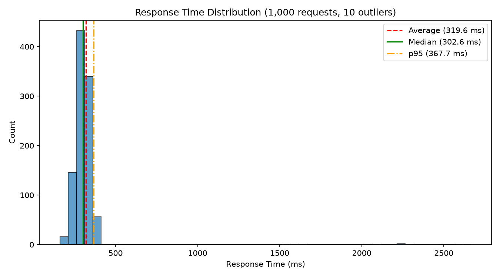

# P3.3 - The Numbers of Performance

Notes on calculating performance numbers by hand, simulating response time percentiles with Python, and understanding why averages are misleading.

---

## 1. By-Hand Calculation

Given response times (ms):  
`120, 130, 125, 140, 135, 128, 132, 138, 127, 2400`

Sorted list:  
`120, 125, 127, 128, 130, 132, 135, 138, 140, 2400`  
Total count = 10

- **Average (mean)**:  
  Sum = 120 + 125 + 127 + 128 + 130 + 132 + 135 + 138 + 140 + 2400 = 3475 ms  
  Average = 3475 / 10 = **347.5 ms**

- **Median**:  
  Average of the 5th and 6th numbers (130 and 132):  
  Median = (130 + 132) / 2 = **131 ms**

- **90th percentile (p90)**:  
  9th value in the sorted list = **140 ms**

### What the average hides
9 out of 10 requests were fast and consistent (between 120 ms and 140 ms). But one single 2400 ms outlier dragged the average all the way up to 347.5 ms.  
The average hides two things:
1. It hides that 90% of requests were fast (~130 ms), making normal performance look worse than it really was.
2. It hides how bad the worst failure actually was (2400 ms), because it gets averaged out with the healthy requests.

---

## 2. Python Simulation (1,000 Response Times)

Simulated in `tools/p3_stats.py` with `random.seed(7)`.  
Traffic model: 990 Gaussian samples (mean 300 ms, std dev 40 ms) + 10 slow outliers (1500 to 3000 ms).

### 10 Outliers vs. 60 Outliers Comparison
- **avg**: 319.6 ms $\rightarrow$ 414.6 ms (jumped by ~95 ms)
- **median**: 302.6 ms $\rightarrow$ 306.2 ms (barely changed)
- **p90**: 352.3 ms $\rightarrow$ 367.7 ms (barely changed)
- **p95**: 367.7 ms $\rightarrow$ **1685.0 ms** (exploded!)
- **p99**: 423.3 ms $\rightarrow$ **2645.6 ms** (exploded!)
- **max**: 2666.5 ms $\rightarrow$ 2889.3 ms

### What happened when outliers increased from 10 to 60:
- Median and p90 stayed virtually the same because 60 outliers only make up 6% of the 1,000 samples. The 50th and 90th percentiles still fall cleanly inside the healthy cluster.
- But p95 exploded from 367 ms to 1685 ms because 6% of outliers cross over the 95% line, immediately exposing that tail latency has gone bad.

Histogram saved to `notes/p3-histogram.png`:  

---

## 3. Performance Metrics Definitions

- **Throughput**: Number of requests completed per second (requests/sec or TPS).
- **Error rate**: Percentage of total requests that failed (failed requests / total requests * 100).
- **Concurrency**: Number of virtual users or requests running on the server at the exact same moment.

---

## 4. Self-Check

**Question**: *Why do performance reports use p95 rather than the average?*

**Answer**:  
Because averages get skewed by outliers and hide tail latency. If 95% of users get a fast 200 ms page load but 5% wait 20 seconds, the average smooths out the spike and hides the problem. Reporting p95 gives an honest guarantee that 95% of users had an experience at or better than that number, which reflects real user satisfaction without getting ruined by single random network glitches.
